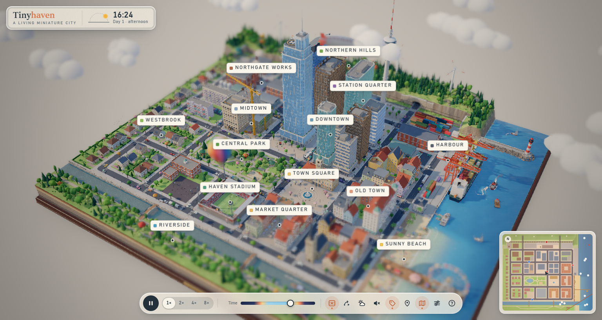

# Tinyhaven — a living miniature city

A handcrafted-looking tabletop diorama of a small harbour city that is alive: cars and buses drive the
street network and obey signals and stop signs, pedestrians walk the sidewalks and cross at crosswalks,
trains stop at the station while level-crossing gates close, ferries and sailboats cross the bay, and the
whole world turns from day to night.

## Run it

* **Double-click `Launch Tinyhaven.cmd`** — opens the finished build (`dist/index.html`).
  The build is a single self-contained HTML file (no internet, no server needed); if Node.js is
  installed the launcher serves it locally at http://127.0.0.1:4173 instead.
* Or: `npm start` (serve `dist/` and open the browser), `npm run dev` (development server with hot reload),
  `npm run build` (rebuild `dist/index.html`).

## Controls

| Action | Mouse | Keyboard |
| --- | --- | --- |
| Rotate | left-drag | Q / E (rotate) · R / F (tilt) |
| Pan | right-drag (also middle- or Shift-drag) | W A S D or arrow keys (Shift = faster) |
| Zoom | scroll — zooms towards the cursor | + / − |
| Follow something | click anything that moves — cars, buses, people, trains, boats, even the balloon, blimp and plane; click a building to take a look | C = chase view · Esc = let go |
| Fly somewhere | double-click a spot · click the minimap | 1…9 = places · 0 = overview · P = places menu |
| Cinematic tour | tour button | T |
| Time | pause / speed buttons and the time-of-day slider | Space = pause · , / . = slower / faster |
| View options | toolbar: tilt-shift, weather, sound, labels, minimap, quality | B tilt-shift · L labels · M minimap · U hide controls · ` frame-rate meter · H help |

Touch: one finger rotates, two fingers pan, pinch to zoom and twist to turn, three fingers tilt; tap
anything that moves to follow it. Sound is off until you switch it on — everything you hear is synthesised live.

## What's in the city

Downtown towers, a pastel old town, the market quarter and town square with its fountain, Central Park
with a pond, a stadium, the suburbs of Westbrook, Northgate Works with smoking chimneys, a working harbour
with gantry cranes and a moored cargo ship, the lighthouse, Sunny Beach and the amusement pier with its
ferris wheel, the river with footbridges, the central station on the railway along the northern hills,
and tunnels where traffic leaves for the rest of the world.

## Project layout

See `docs/ARCHITECTURE.md`. In short: `src/core/` holds the city plan and the simulation graphs
(lanes, intersections, walkways), each subsystem lives in its own module under `src/world`, `src/sim`,
`src/render` and `src/ui`, and `scripts/shot.mjs` is a headless verification harness
(`node scripts/shot.mjs --view downtown --hours 21 --stats --invariants`).
